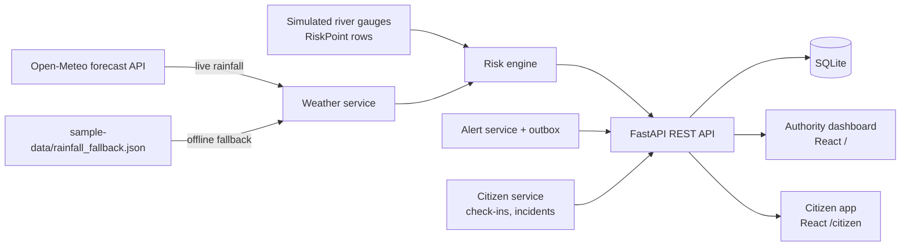
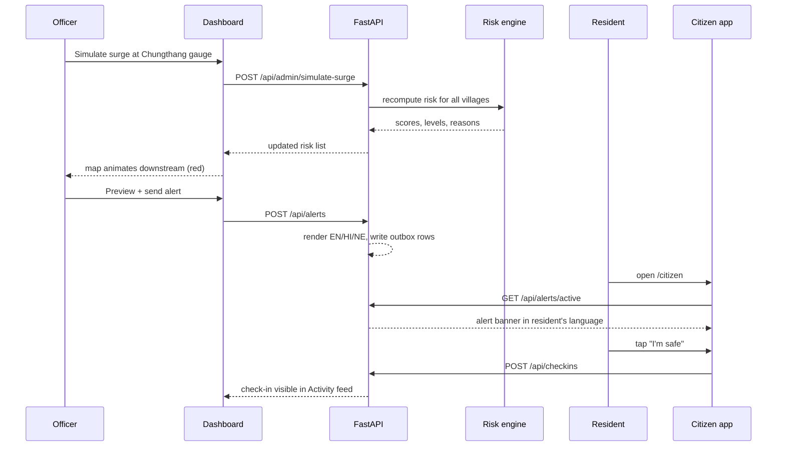

# Architecture

## Component diagram

## Sequence diagram — core demo flow

## Module map

**Backend** (`backend/app/`)
- `main.py` — app wiring: CORS, routers, static uploads, startup seeding
- `config.py` — settings from environment/`.env`
- `db.py`, `models.py` — SQLAlchemy engine/session and ORM models
- `schemas.py` — Pydantic request/response models
- `security.py` — admin-token dependency
- `seed.py` — loads `sample-data/*.json` into an empty database
- `services/geo.py` — haversine distance, nearest-N lookups
- `services/weather.py` — live Open-Meteo fetch with cache and offline fallback
- `services/risk_engine.py` — pure, deterministic risk scoring and reasons
- `services/alerts.py` — alert message rendering (EN/HI/NE)
- `routers/*.py` — HTTP endpoints, one module per resource group

**Frontend** (`frontend/src/`)
- `api/` — typed fetch client mirroring the backend schemas
- `hooks/` — polling and language-preference hooks
- `i18n/strings.ts` — citizen-app UI strings in EN/HI/NE
- `lib/` — risk-level colors, number/distance formatting, geo helpers
- `components/` — map, panels, composer, feed, demo controls
- `pages/Dashboard.tsx`, `pages/Citizen.tsx` — the two user-facing apps

## Key design decisions

- **Pure-function risk engine.** `risk_engine.py` takes plain data in and returns a score, level and reasons — no DB or HTTP inside. This makes it trivially unit-testable and lets the README show the exact formula without hand-waving.
- **Offline fallback everywhere.** Weather falls back to bundled sample data on any network failure or `WEATHER_MODE=offline`. The demo never breaks because of a flaky connection or jury wifi.
- **SQLite.** Zero setup for a fresh clone; swappable to Postgres later by changing `DATABASE_URL` alone, since all access goes through SQLAlchemy.
- **Polling, not websockets.** Simpler to build, test and reason about, and works on the poor mobile networks disaster responders actually have.
- **Reasons rendered in three languages from the backend.** One source of truth for "why this score" and alert text, so the dashboard (English) and citizen app (EN/HI/NE) never drift apart.
- **No login system.** The jury's priorities rank "runs first time from a fresh clone" and "demo never breaks" above anything else; an admin-token header is enough to gate write actions in a prototype.

## Scaling path

- Move from SQLite to PostgreSQL + PostGIS for proper spatial queries at scale.
- Replace simulated gauges and lake levels with real state sensor feeds.
- Replace the simulated outbox with a real SMS gateway and CAP-format alerts.
- Add new river basins/states as new sample-data files, not new code.
- Containerise the backend and frontend for a real deployment.
