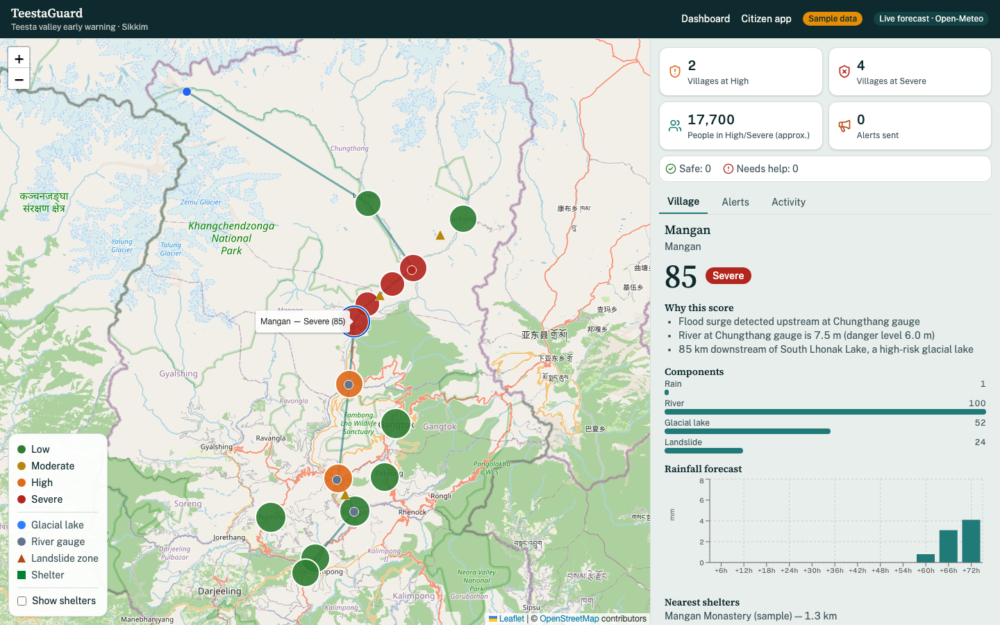
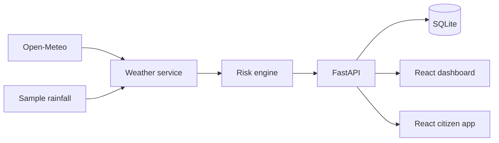

# TeestaGuard — last-mile flood and glacial-lake-outburst warning for Sikkim's Teesta valley

Hack for Social Cause 2027 · Theme: Disaster Mitigation & Resilience · State: Sikkim



## The problem

On the night of 3–4 October 2023, South Lhonak glacial lake in North Sikkim burst. The flood destroyed the 1,200 MW Teesta III dam at Chungthang and ran down the Teesta into West Bengal. The Government of Sikkim reported 46 deaths, 77+ missing and 88,400 people affected ([source](https://iee.psu.edu/news/blog/glacier-lake-outburst-floods-loss-life-and-infrastructure)). The lake's early-warning system was still being installed at the time ([source](https://gulfnews.com/world/asia/india/early-warning-system-for-indias-flooded-glacial-lake-was-delayed-by-a-year-1.1697025573287)). Sikkim now monitors its 16 high-risk glacial lakes with sensors ([source](https://eastmojo.com/sikkim/2026/08/31/sikkim-monitoring-16-high-risk-glacial-lakes-offers-glof-expertise-to-nepal/)), but the last mile is still missing: raw sensor data is not turned into a risk level per village, alerts must reach people in Nepali/Hindi within minutes, and responders cannot see who is safe.

## What TeestaGuard does

**Authority dashboard**
- Village risk map, colour-coded and labelled Low → Severe
- Plain-language reasons behind every score
- One-click alerts, previewed in English, Hindi and Nepali
- Live feed of citizen check-ins and incident reports
- "Simulate surge" demo control that shows risk propagating downstream in real time

**Citizen app**
- My risk, in my language (English/Hindi/Nepali)
- "I'm safe" / "I need help" check-in
- Nearest three shelters with directions
- Report flooding, landslide or a blocked road, with a photo

## How the risk score works

Each village's score (0–100) is a weighted sum of four components, each also 0–100:

| Component | Weight | Fed by |
|---|---|---|
| Rain | 30% | 24h and 72h rainfall forecast |
| River | 30% | Nearest downstream gauge level vs. danger level, with surge propagation from any gauge over its danger level |
| Glacial lake (GLOF) | 20% | Distance downstream of South Lhonak lake |
| Landslide | 20% | Slope class + nearby landslide zones, scaled by rainfall |

**Imminent-flood override:** if the river component reaches 60+, the score is raised to at least 85% of the river component — a flood surge can't be diluted away by otherwise-calm rain or slope numbers.

**Levels:** Low (score < 30) · Moderate (30–54) · High (55–74) · Severe (75+).

This is a transparent, deterministic formula — no AI model decides risk. See [`backend/app/services/risk_engine.py`](backend/app/services/risk_engine.py).

## Quick start

Prerequisites: Python 3.11+, Node 18+.

**Backend**

```bash
cd backend
python -m venv .venv
# Windows: .venv\Scripts\activate    macOS/Linux: source .venv/bin/activate
pip install -r requirements.txt
cp .env.example .env            # Windows: copy .env.example .env
uvicorn app.main:app --reload --port 8000
```

**Frontend** (in a second terminal)

```bash
cd frontend
npm install
cp .env.example .env            # Windows: copy .env.example .env
npm run dev
```

- Dashboard: http://localhost:5173
- Citizen app: http://localhost:5173/citizen
- API docs: http://localhost:8000/docs
- Default admin token for the demo is `change-me-demo` (see `backend/.env.example`) — never use this in a real deployment.

## Demo in 2 minutes

1. Open the dashboard, click Chungthang on the map.
2. Open **Demo controls** → **Simulate surge** — watch risk travel downstream village by village.
3. Click **New alert**, preview the message in English, Hindi and Nepali, then **Send alert**.
4. Open `/citizen`, choose a downstream village — the alert banner shows in that resident's language.
5. Tap **I'm safe** — it appears in the dashboard's Activity feed within 5 seconds.
6. Report an incident with a photo from the citizen app — it appears with a thumbnail on the dashboard.
7. Open **Demo controls** → **Reset demo**.

## Architecture



Full diagrams and design decisions: [`ARCHITECTURE.md`](ARCHITECTURE.md).

## API overview

All endpoints are prefixed `/api`; admin routes require header `X-Admin-Token`.

| Method & path | Purpose |
|---|---|
| `GET /api/health` | Service + weather-source status |
| `GET /api/villages` | List all villages |
| `GET /api/riskpoints` | Glacial lake, gauges, landslide zones |
| `GET /api/shelters`, `/api/shelters/nearest` | Shelters, nearest-N by location |
| `GET /api/risk`, `/api/risk/{village_id}`, `/api/risk/at` | Risk list, detail, nearest-village-to-a-point |
| `GET /api/alerts/preview` | Rendered alert preview (not persisted) |
| `POST /api/alerts` (admin) | Send an alert |
| `GET /api/alerts`, `/api/alerts/active` | Alert history, active alerts for a village |
| `POST /api/checkins`, `GET /api/checkins` | Citizen check-ins |
| `POST /api/incidents`, `GET /api/incidents` | Citizen incident reports (photo upload) |
| `POST /api/admin/simulate-surge`, `POST /api/admin/reset` (admin) | Demo controls |
| `GET /api/stats` | Dashboard KPI aggregates |

Full request/response shapes: http://localhost:8000/docs once the backend is running.

## Tests

```bash
cd backend && pytest -q
```

27 tests, all passing, run against a temporary SQLite database with `WEATHER_MODE=offline` (no network required). They cover geo math, every risk-engine threshold and the Chungthang surge worked example, alert rendering and outbox behaviour, every API endpoint, and upload validation (valid PNG accepted, fake/oversize files rejected).

## Data and sources

Full table: [`DATA.md`](DATA.md). In short: village, gauge, shelter and rainfall-fallback data is approximate sample data prepared by the team for this prototype; live rainfall comes from Open-Meteo when available.

## Limitations (honest)

- Sample village data is approximate; gauge readings are simulated, not live sensor feeds.
- SMS sending is simulated (an in-database outbox) — no real SMS gateway is wired up.
- The admin token is a demo stand-in for real authentication.
- Hindi and Nepali text awaits native-speaker review (see `frontend/src/i18n/strings.ts`).
- This is a hackathon prototype, not a replacement for official warnings from SSDMA, IMD or CWC.

## Roadmap

- **Nov 2026** — validation with district disaster officials and real gauge data.
- **Dec 2026–Jan 2027** — real SMS gateway, CAP-format alerts, offline mode for the citizen app, Nepali voice alerts, Mangan district pilot plan.
- **Later** — extend to other Himalayan states.

## Team

| Name | Institution | Role |
|---|---|---|
| [Team Name] | — | — |
| Arka Bera | Sikkim Manipal Institute of Technology | Team Lead — backend, risk engine, architecture |
| [Member 2] | — | — |
| [Member 3] | — | — |

## AI tool use

This project was built with substantial AI assistance from Claude Code, under team direction and review — see [`AI_DISCLOSURE.md`](AI_DISCLOSURE.md) for the full breakdown.

## Licence

MIT — see [`LICENSE`](LICENSE).
